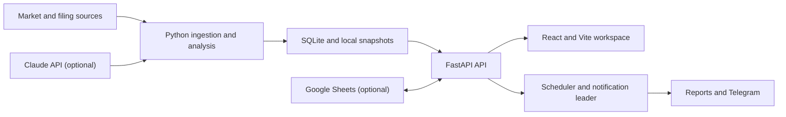

# Stock Radar

[](https://github.com/yankesswang/Stock-Radar/actions/workflows/quality.yml)

Local-first investment research workspace for valuation, technical signals,
portfolio risk, earnings intelligence, and post-market decision support.

Stock Radar combines a FastAPI analytics backend with a React operations
console. It is designed for an individual research workflow: market data stays
local, scheduled analysis runs on the same machine, and external integrations
are optional.

> Stock Radar is a research tool, not financial advice or an order-execution
> system. Validate market data and decisions independently before trading.

## Highlights

- **War Room** — portfolio directives, market regime, risk flags, opportunity
  tracking, daily reports, and decision history in one operational view.
- **Valuation** — PE history, analyst forecasts, DCF scenarios, peer comparison,
  and 60+ financial metrics.
- **Technical research** — candlesticks, support/resistance, trend lines,
  relative strength, volatility, volume profile, and multi-indicator signals.
- **Portfolio intelligence** — manual portfolios and optional Google Sheets
  synchronization with live P&L, allocation, and risk context.
- **Earnings workflow** — calendar, filings, segment data, non-GAAP metrics,
  conclusions, theses, and source-aware notes.
- **Automated briefings** — scheduled post-market review, opportunity scanning,
  news curation, integrity manifests, and Telegram notifications.
- **Local-first safety** — SQLite storage, protected mutation endpoints,
  single-leader background jobs, request IDs, and durable asynchronous jobs.

## Architecture



| Layer | Technology | Responsibility |
|---|---|---|
| Web | React 19, Vite, Tailwind, Recharts, Lightweight Charts | Research and operations UI |
| API | FastAPI, Pydantic, SQLAlchemy | Typed endpoints, orchestration, persistence |
| Storage | SQLite, Alembic, JSON/CSV snapshots | Local state and reproducible schema changes |
| Analysis | pandas, NumPy, yfinance, custom scrapers | Valuation, indicators, rankings, reports |
| Automation | asyncio scheduler, file-backed jobs | Daily pipelines and notifications |

## Requirements

- Python 3.10–3.13
- [uv](https://docs.astral.sh/uv/)
- Node.js 22 or later and npm
- macOS or Linux recommended for scheduled workflows

Optional integrations require their own credentials: Google Sheets, Telegram,
Anthropic, and Cloudflare Tunnel.

## Quick start

### 1. Install dependencies

```bash
git clone https://github.com/yankesswang/Stock-Radar.git
cd Stock-Radar

uv sync --dev --frozen
npm --prefix frontend ci
```

### 2. Configure the backend

```bash
cp backend/.env.example backend/.env
```

The application works without optional integrations. Configure only the
services you need:

| Variable | Purpose | Required |
|---|---|---|
| `DATABASE_URL` | SQLAlchemy connection URL; defaults to local SQLite | No |
| `GSHEET_ID` | Read-only portfolio spreadsheet | No |
| `GSHEET_WRITEBACK_ENABLED` | Enable bidirectional Sheets synchronization | No |
| `TELEGRAM_TOKEN` / `TELEGRAM_CHAT_ID` | Notification delivery | No |
| `ANTHROPIC_API_KEY` | AI-assisted reports and analysis | No |
| `MIMI_DOC_PATH` | Local strategy-note source | No |
| `ADMIN_API_TOKEN` | Protect state-changing API requests | Recommended |
| `BACKGROUND_JOBS_ENABLED` | Run scheduler and notification loops | No; defaults to `true` |

Never commit `backend/.env`, service-account JSON, database files, or access
tokens.

### 3. Initialize the database

```bash
uv run alembic upgrade head
uv run python -m backend.load_data
```

`backend.load_data` imports the available local snapshots. It is safe to start
with an empty dataset and populate sources later.

### 4. Start the application

```bash
./start.sh
```

Default local addresses:

- Web: <http://localhost:4000>
- API: <http://localhost:6000>
- API documentation: <http://localhost:6000/docs>

Override ports with `STOCKS_FRONTEND_PORT` and `STOCKS_BACKEND_PORT`.
If `cloudflared` is installed, `start.sh` also starts a temporary public tunnel.

To run services separately:

```bash
# API
uv run uvicorn backend.app.main:app --host 127.0.0.1 --port 6000 --reload

# Web
STOCKS_BACKEND_PORT=6000 npm --prefix frontend run dev -- --port 4000
```

## Security model

Read requests are available to the configured CORS origins. State-changing
`/api` requests follow these rules:

1. With no `ADMIN_API_TOKEN`, mutations are accepted only from loopback.
2. With a token configured, every mutation must provide either
   `X-API-Key: <token>` or `Authorization: Bearer <token>`.
3. The web client reads the token from the browser local-storage key
   `stock-radar-admin-token`.

For remote access, configure `ADMIN_API_TOKEN`, terminate TLS at a trusted
gateway, and restrict network exposure. The development tunnel is not a
production deployment configuration.

## Data and background jobs

Schema changes are managed exclusively through Alembic:

```bash
uv run alembic current
uv run alembic upgrade head
```

Only one API process acquires the background-job leader lock. Other workers can
serve HTTP requests without duplicating scheduled reports or notifications.

Long-running data reloads return immediately with `202 Accepted`:

```bash
curl -X POST http://localhost:6000/api/data/reload \
  -H "X-API-Key: $STOCK_RADAR_ADMIN_TOKEN"

curl http://localhost:6000/api/data/jobs/<job-id>
```

The daily and weekly reporting workflow is documented in
[`docs/FLOW.md`](docs/FLOW.md).

## Common workflows

Refresh analysis from existing source data:

```bash
uv run python main.py
```

Run scraping followed by analysis:

```bash
uv run python main.py --scrape
```

Refresh the discovery universe or live prices:

```bash
uv run python scripts/refresh_discovery_universe.py
uv run python scripts/refresh_prices.py
```

Run a post-market report manually:

```bash
uv run python scripts/war_room.py
uv run python scripts/war_room_report.py
```

Individual data-source scripts live under `src/scrapers/` and `scripts/`.
Generated data is intentionally excluded from version control unless it is a
small, curated project input.

## API overview

FastAPI publishes the complete OpenAPI contract at `/docs`. Major endpoint
groups include:

| Prefix | Purpose |
|---|---|
| `/api/stocks` | Stock profiles, charts, ratios, forecasts, DCF, options, filings |
| `/api/valuations` | Valuation list and screening data |
| `/api/signals` | Technical signal scanning and watchlists |
| `/api/portfolio` | Portfolios, holdings, deposits, and Google Sheets sync |
| `/api/war-room` | Decisions, journals, risk context, and daily operations |
| `/api/opportunities` | Discovery and ranked market setups |
| `/api/earnings` | Calendar and earnings workflow |
| `/api/stock-chat` | Contextual research sessions |
| `/api/data` | Dataset status, reload jobs, and job status |
| `/api/health` | Liveness check |

## Quality checks

Run the same checks used by CI:

```bash
# Backend
uv run ruff check .
uv run pytest

# Frontend
npm --prefix frontend run lint -- --quiet
npm --prefix frontend test
npm --prefix frontend run build
npm --prefix frontend audit --omit=dev
```

GitHub Actions runs backend and frontend checks independently on every push and
pull request.

## Repository layout

```text
stock-radar/
├── backend/
│   ├── app/
│   │   ├── main.py            # FastAPI application and lifecycle
│   │   ├── routers/           # HTTP endpoint groups
│   │   └── services/          # Persistence and integration services
│   └── load_data.py           # Snapshot-to-database import
├── frontend/
│   └── src/
│       ├── components/        # Shared research and operations UI
│       ├── lib/               # API client and browser infrastructure
│       └── pages/             # Route-level views
├── migrations/                # Alembic revisions
├── scripts/                   # Reporting, earnings, refresh, and QA workflows
├── src/                       # Core analysis and scraper package
├── tests/                     # Backend tests
├── data/                      # Local and curated datasets
├── docs/                      # Operational and indicator documentation
├── pyproject.toml             # Python dependencies and tool configuration
└── uv.lock                    # Reproducible Python dependency lock
```

## Documentation

- [Daily and weekly pipeline](docs/FLOW.md)
- [Technical indicator guide](docs/indicators.md)
- [Support and resistance methodology](docs/support_resistance.md)
- [DCF model notes](docs/DCF_README.md)
- [Earnings pipeline](scripts/earnings/README.md)

## Contributing

Keep changes focused and include tests for new domain logic. Database changes
must include an Alembic revision. Before opening a pull request, run the quality
checks above and confirm that no credentials or generated portfolio databases
are staged.
